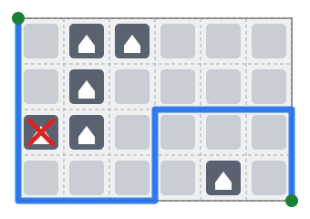

# تخلیه‌ی سریع‌السیر

| | |
|---|---|
| ورودی | ورودی استاندارد |
| خروجی | خروجی استاندارد |
| محدودیت زمان | ۱ ثانیه |
| محدودیت حافظه | ۲۵۶ مگابایت |

سرزمین بایتوجا یک مستطیل است که از $H \cdot W$ خانه تشکیل شده و این خانه‌ها در $H$ سطر و $W$ ستون چیده شده‌اند.
مرز هر خانه یک جاده‌ی محلی کم‌تردد است (مرز بیرونی سرزمین هم جاده حساب می‌شود).
هر خانه یا خالی است یا دقیقاً یک ساکن دارد.
ساکنان آرامش را دوست دارند و نمی‌خواهند درست کنار بزرگراه جدید زندگی کنند.

شما باید مسیر بزرگراه را از گوشه‌ی بالا-چپ تا گوشه‌ی پایین-راست بایتوجا طراحی کنید.
بزرگراه فقط می‌تواند روی جاده‌های موجود، یعنی روی مرز خانه‌ها، ساخته شود.
طول مسیر و تعداد پیچ‌های آن اهمیتی ندارد.

هر ساکنی که خانه‌اش با بزرگراه مجاور باشد، چه از یک ضلع و چه حتی فقط از یک گوشه، باید تخلیه شود.
به بیان دیگر، اگر بزرگراه دست‌کم از یکی از چهار رأس گوشه‌ی یک خانه‌ی مسکونی عبور کند، ساکن آن خانه تخلیه می‌شود.

کمترین تعداد ساکنانی که باید تخلیه شوند چند است؟

## ورودی

سطر اول شامل دو عدد صحیح $H$ و $W$ است که ابعاد سرزمین را مشخص می‌کنند.

در هر یک از $H$ سطر بعدی رشته‌ای به طول $W$ آمده است که فقط از نویسه‌های `.` برای خانه‌ی خالی و `#` برای خانه‌ی مسکونی تشکیل شده است.

## خروجی

یک عدد صحیح چاپ کنید: کمترین تعداد ممکن ساکنان تخلیه‌شده.

## محدودیت‌ها

* $1 \le H, W \le 50$
* هر سطر دقیقاً $W$ نویسه دارد و هر نویسه یا `.` است یا `#`.

## زیرمسئله‌ها

| زیرمسئله | امتیاز | محدودیت اضافه |
|:---:|:---:|---|
| ۱ | ۶ | $H = 1$ |
| ۲ | ۱۴ | حداکثر $12$ خانه‌ی مسکونی وجود دارد |
| ۳ | ۱۸ | جواب حداکثر $1$ است |
| ۴ | ۱۷ | $H \le 2$ |
| ۵ | ۴۵ | بدون محدودیت اضافه |

## مثال

**ورودی**

```
4 6
.##...
.#....
##....
....#.
```

**خروجی**

```
1
```

## توضیح

اگر ساکن خانه‌ی سطر سوم و ستون اول را تخلیه کنیم، می‌توان بزرگراه را مانند شکل زیر ساخت.
خانه‌های مسکونی تیره هستند، خانه‌ی تخلیه‌شده با ضربدر قرمز مشخص شده و بزرگراه آبی است.


