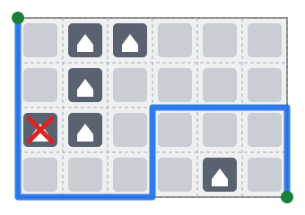

# Express Eviction

| | |
|---|---|
| Input | standard input |
| Output | standard output |
| Time limit | 1 second |
| Memory limit | 256 megabytes |

Bajtocja is a rectangular land consisting of $H \cdot W$ cells arranged in $H$ rows and $W$ columns.
The border of each cell is a local road with little traffic (this includes the outer border of the land).
Each cell is either empty or inhabited by one resident.
The residents like peace and would not want to live right next to a planned express road.

Your task is to plan the route of the express road from the upper-left corner to the lower-right corner of Bajtocja.
The route can only run along existing roads, i.e. along cell borders.
The length and the number of turns of the route do not matter.

Every resident whose cell is adjacent to the express road — by a side or even only by a corner —
has to be evicted. In other words, a resident is evicted if the road passes through at least one of the
four corner points of their cell.

What is the minimum number of residents that need to be evicted?

## Input

The first line contains two integers $H$ and $W$ — the dimensions of Bajtocja.

Each of the next $H$ lines contains a string of length $W$ consisting of characters `.` (empty cell) and `#` (inhabited cell).

## Output

Output a single integer — the minimum possible number of evicted residents.

## Constraints

* $1 \le H, W \le 50$
* Each row contains exactly $W$ characters, each of them `.` or `#`.

## Subtasks

| Subtask | Score | Additional constraints |
|:---:|:---:|---|
| 1 | 6 | $H = 1$ |
| 2 | 14 | There are at most $12$ inhabited cells |
| 3 | 18 | The answer is at most $1$ |
| 4 | 17 | $H \le 2$ |
| 5 | 45 | No additional constraints |

## Example

**Input**

```
4 6
.##...
.#....
##....
....#.
```

**Output**

```
1
```

## Note

If you evict the resident from the cell in the first column and the third row, you can build the express road as follows
(houses are dark, the evicted one is crossed, the road is blue):


